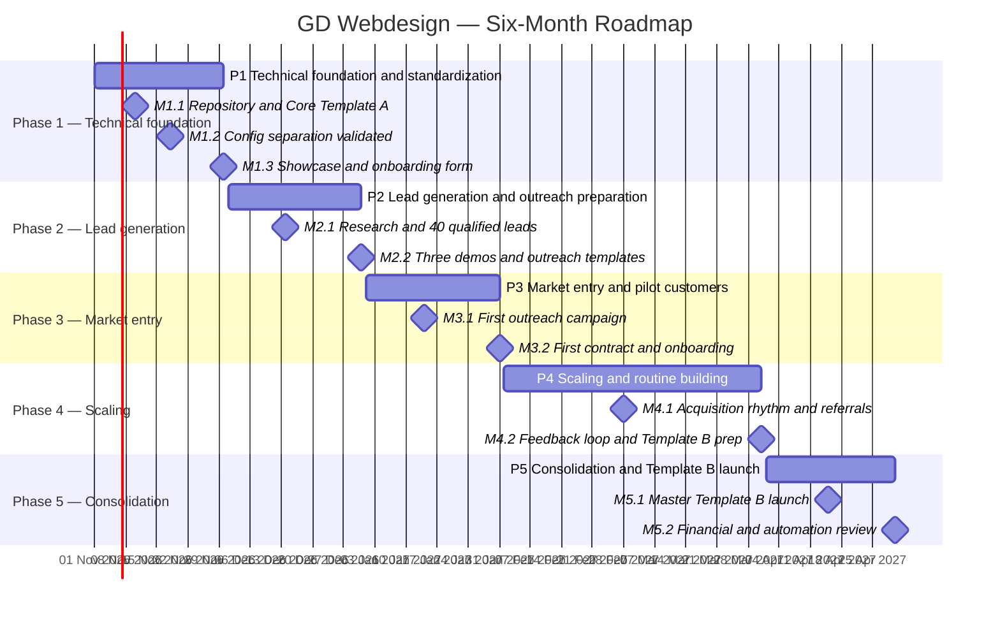

# Project Roadmap — GD Webdesign

**Project start:** 2026-11-01  
**Planning horizon:** 6 months, through 2027-04-30  
**Status convention:** All entries start as **Planned**. Dates are calendar-based estimates derived from the six-month phases and milestone sequence in `Roadmap_und_Kalkulation.md`; they are not claims that work has already started or completed.

## Overview

The roadmap follows the source plan's five phases:

1. **Technical foundation & standardization (November 2026):** establish the repository and core template, validate content/config separation, and prepare the agency showcase and onboarding form.
2. **Lead generation & outreach preparation (December 2026):** research local businesses, build a qualified list of at least 40 leads, and prepare three branded demos plus outreach templates.
3. **Market entry & pilot customers (January 2027):** run the first outreach campaign, onboard the first paying customer(s), and validate the end-to-end delivery process.
4. **Scaling & routine building (February–March 2027):** establish a consistent outreach rhythm, encourage referrals, optimize reusable components, and prepare Master Template B.
5. **Consolidation & Template B launch (April 2027):** launch the second template for service providers/studios and review finances and automation.

The original plan describes the target outcomes as a qualified 40-lead pipeline in Phase 2, 1–2 paying pilot customers in Phase 3, 4–6 active customers across Phases 4–5, and 8–10 active support contracts by the end of Month 6. These are targets, not guaranteed results.

## Gantt schedule

## Milestone register

| ID | Phase | Task / milestone | Start date | End date | Status |
|---|---|---|---|---|---|
| P1 | 1 — Technical foundation | Technical foundation and standardization | 2026-11-01 | 2026-11-30 | Planned |
| M1.1 | 1 — Technical foundation | GitHub repository, workflows, responsive Master Template A, local fonts | 2026-11-01 | 2026-11-10 | Completed |
| M1.2 | 1 — Technical foundation | Move customer-specific content into `config.json`; test sample-business setup under 20 minutes | 2026-11-11 | 2026-11-18 | Planned |
| M1.3 | 1 — Technical foundation | Agency showcase one-pager and mobile onboarding form | 2026-11-19 | 2026-11-30 | Planned |
| P2 | 2 — Lead generation | Lead generation and outreach preparation | 2026-12-01 | 2026-12-31 | Planned |
| M2.1 | 2 — Lead generation | Research local businesses and compile at least 40 qualified leads | 2026-12-01 | 2026-12-14 | Planned |
| M2.2 | 2 — Lead generation | Brand three demo sites and prepare WhatsApp, email, and phone outreach templates | 2026-12-15 | 2026-12-31 | Planned |
| P3 | 3 — Market entry | Market entry and pilot customers | 2027-01-01 | 2027-01-31 | Planned |
| M3.1 | 3 — Market entry | Send the three demos and conduct the first outreach follow-ups | 2027-01-01 | 2027-01-14 | Planned |
| M3.2 | 3 — Market entry | Sign first contract(s), onboard customer, launch on customer domain with SSL, review delivery effort | 2027-01-15 | 2027-01-31 | Planned |
| P4 | 4 — Scaling | Scaling and routine building | 2027-02-01 | 2027-03-31 | Planned |
| M4.1 | 4 — Scaling | Establish five personalized contacts per week and start referral marketing | 2027-02-01 | 2027-02-28 | Planned |
| M4.2 | 4 — Scaling | Analyze feedback, improve reusable CSS/JS components, prepare Master Template B | 2027-03-01 | 2027-03-31 | Planned |
| P5 | 5 — Consolidation | Consolidation and Template B launch | 2027-04-01 | 2027-04-30 | Planned |
| M5.1 | 5 — Consolidation | Launch Master Template B for fitness, beauty, and practice/service businesses; include booking links and pricing tables | 2027-04-01 | 2027-04-15 | Planned |
| M5.2 | 5 — Consolidation | Review customer-care time against recurring revenue and assess automation level | 2027-04-16 | 2027-04-30 | Planned |

## Phase exit targets

| Phase | Target outcome |
|---|---|
| 1 | A sales-ready Master Template A, validated `config.json` workflow, agency showcase, and onboarding form |
| 2 | At least 40 qualified regional leads, three demo prototypes, and prepared outreach scripts |
| 3 | 1–2 paying pilot customers and a tested end-to-end onboarding and launch process |
| 4 | Progress toward 4–6 active customers, repeatable outreach, and a prepared second template |
| 5 | Target of 8–10 active support contracts, Master Template B launched, and financial/automation review completed |

## Planning notes

- The start date is fixed at **2026-11-01**. Phase boundaries follow calendar months for readability.
- **M1.1 Early Acceptance:** M1.1 was formally accepted by the user on **2026-10-31**, ahead of its planned calendar window (2026-11-01 to 2026-11-10). The planned dates in the schedule are preserved to maintain visibility of the original planning estimates versus actual acceptance.
- The source roadmap uses relative labels such as “Tag 1–10” and “Woche 5–6” without explicit calendar dates. The specific dates above are a practical schedule interpretation anchored to the required start date; adjust them if execution capacity or dependencies change.
- Financial assumptions and the 12-month revenue scenario remain in the source document and are intentionally not duplicated here.
