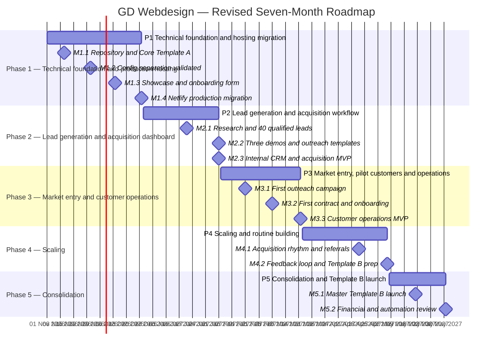

# Project Roadmap — GD Webdesign

**Project start:** 2026-11-01  
**Revised planning horizon:** 7 months, through 2027-05-31  
**Revision:** Hosting migration and staged internal dashboard scope added on 2026-11-17.  
**Status convention:** Dates are estimates, not evidence of completion. All new work starts as **Planned** unless repository evidence supports another status.

## Overview

The original six-month plan is extended by approximately one month. The main reasons are:
- The current agency repository is still public and the live preview is still on GitHub Pages. Netlify must be configured and verified before GitHub Pages is retired; the repository must become private before the production launch.
- The complete customer configuration work and agency showcase still belong to Phase 1.
- The accepted internal dashboard scope adds two deliberately staged milestones: acquisition/lead workflow in Phase 2 and customer operations in Phase 3.
- Lead research and manual outreach preparation can proceed while the first dashboard module is being built. The dashboard must not become a prerequisite for validating the market.

The roadmap keeps the original commercial targets as goals, not guarantees: at least 40 qualified leads, 1–2 paying pilot customers, 4–6 active customers during scaling, and a target of 8–10 active support contracts by the end of the revised horizon.

## Target repository and deployment architecture

- **Agency website and master templates:** retain the existing `GkhnDgl/GD-Webdesign` repository initially. It remains public during development, then is switched to private as part of the approved production migration. Netlify serves the public agency website; private source code does not make the published website private.
- **Internal dashboard:** separate private repository and separate Netlify project, with authentication and a protected backend. It is not an `/admin` area of the public agency website.
- **Customer websites:** create a separate private GitHub repository and separate Netlify project for each customer when that customer project is started. Do not create empty customer repositories in advance.
- **Shared backend services:** evaluate Supabase for database, authentication, and private file storage; use Netlify Functions for privileged server-side operations. Select concrete plans and configure access controls before implementation.
- **Domains:** initially manage domain registration and DNS manually through the selected provider. Preserve the customer as the legal domain holder; document delegated technical administration.
- **Automation:** start with assisted workflows and explicit user approval before consequential actions. Do not send unsolicited marketing messages automatically. Lead research and contact preparation must respect applicable privacy and marketing rules.

See [Architecture & Hosting Decisions](architecture.md) for boundaries, security requirements, and the staged operating model.

## Revised Gantt schedule

The dates below are planning estimates based on the current project state as of 2026-11-17. Parallel work is intentional where noted.

## Milestone register

| ID | Phase | Task / milestone | Start date | End date | Status |
|---|---|---|---|---|---|
| P1 | 1 — Technical foundation | Technical foundation, standardization, and production hosting migration | 2026-11-01 | 2026-12-21 | In progress |
| M1.1 | 1 — Technical foundation | GitHub repository, workflows, responsive Master Template A, local fonts | 2026-11-01 | 2026-11-10 | Completed |
| M1.2 | 1 — Technical foundation | Move customer-specific content into `config.json`; test sample-business setup under 20 minutes | 2026-11-11 | 2026-11-24 | In progress |
| M1.3 | 1 — Technical foundation | Agency showcase one-pager and mobile onboarding form | 2026-11-25 | 2026-12-07 | Planned |
| M1.4 | 1 — Technical foundation | Audit public repository and Git history; connect Netlify; verify build, forms, headers, assets, redirects, and production behavior; switch repository to private after successful validation; configure domain/HTTPS; retire GitHub Pages only after user acceptance | 2026-12-08 | 2026-12-21 | Planned |
| P2 | 2 — Lead generation | Lead generation, outreach preparation, and acquisition dashboard | 2026-12-22 | 2027-01-31 | Planned |
| M2.1 | 2 — Lead generation | Research local businesses and compile at least 40 qualified leads | 2026-12-22 | 2027-01-14 | Planned |
| M2.2 | 2 — Lead generation | Brand three demo sites and prepare WhatsApp, email, and phone outreach templates | 2027-01-15 | 2027-01-31 | Planned |
| M2.3 | 2 — Lead generation | Build the private internal CRM/acquisition MVP: lead records, pipeline, research notes and scoring, AI-assisted website analysis and contact-draft preparation, review/approval before actions, and response tracking | 2027-01-05 | 2027-01-31 | Planned |
| P3 | 3 — Market entry | Market entry, pilot customers, and customer operations | 2027-02-01 | 2027-03-15 | Planned |
| M3.1 | 3 — Market entry | Send the three demos and conduct the first outreach follow-ups using the approved, legally permitted channels | 2027-02-01 | 2027-02-14 | Planned |
| M3.2 | 3 — Market entry | Sign first contract(s), onboard customer, launch on customer domain with SSL, review delivery effort | 2027-02-15 | 2027-02-28 | Planned |
| M3.3 | 3 — Market entry | Extend the dashboard for active customers: contacts, contracts, domains, websites/Netlify projects, service tasks, maintenance status, activity history, and a read-only financial overview; no bookkeeping or invoicing engine in this MVP | 2027-03-01 | 2027-03-15 | Planned |
| P4 | 4 — Scaling | Scaling and routine building | 2027-03-16 | 2027-04-30 | Planned |
| M4.1 | 4 — Scaling | Establish five personalized contacts per week and start referral marketing | 2027-03-16 | 2027-04-15 | Planned |
| M4.2 | 4 — Scaling | Analyze feedback, improve reusable CSS/JS components, prepare Master Template B | 2027-04-16 | 2027-04-30 | Planned |
| P5 | 5 — Consolidation | Consolidation and Template B launch | 2027-05-01 | 2027-05-31 | Planned |
| M5.1 | 5 — Consolidation | Launch Master Template B for fitness, beauty, and practice/service businesses; include booking links and pricing tables | 2027-05-01 | 2027-05-15 | Planned |
| M5.2 | 5 — Consolidation | Review customer-care time against recurring revenue, operating costs, and the appropriate next automation level | 2027-05-16 | 2027-05-31 | Planned |

## Phase exit targets

| Phase | Target outcome |
|---|---|
| 1 | Sales-ready Master Template A, validated `config.json` workflow, agency showcase and onboarding form, and accepted public Netlify production deployment from a private source repository |
| 2 | At least 40 qualified regional leads, three demo prototypes, prepared outreach scripts, and a usable private acquisition/CRM MVP |
| 3 | 1–2 paying pilot customers, tested end-to-end onboarding and launch process, and a customer operations MVP for managing active engagements |
| 4 | Progress toward 4–6 active customers, repeatable outreach, and a prepared second template |
| 5 | Target of 8–10 active support contracts, Master Template B launched, and financial/automation review completed |

## Scope boundaries and dependencies

- M1.4 is a release gate for the agency website, not a reason to stop all Phase 2 preparation. Lead research and demo preparation may proceed while migration work is being completed.
- Do not switch the repository to private until Netlify's Git integration has been verified with the intended permissions and the production deployment has been tested. Do not disable GitHub Pages until the Netlify site, domain, HTTPS, forms, and critical journeys have been accepted.
- If a credential was ever committed to the public repository or its history, revoke/rotate it. Making the repository private does not undo prior exposure.
- M2.3 is intentionally a small internal MVP. Manual lead research remains valid; do not delay outreach while building advanced scraping, bulk automation, or integrations.
- M3.3 depends on the customer and contract data model established during the first pilot. Keep finance to operational metrics (revenue, recurring revenue, costs, payment/contract status); use a dedicated accounting/invoicing provider rather than building bookkeeping into this milestone.
- The dashboard is private and authenticated. Employee roles and a customer portal are future extensions, not MVP requirements.
- Customer repositories and Netlify projects are created per actual customer project, not pre-provisioned.
- Use explicit user approval before changing repository visibility, production domains/DNS, production deployment settings, or sending external communications.
- The revised plan adds approximately four weeks to the original horizon. If the current M1.2/M1.3 work or the Netlify migration exceeds the estimates, move downstream dates rather than compressing testing and acceptance.

## Planning notes

- The original start date remains **2026-11-01**. The revised horizon ends **2027-05-31**.
- **M1.1 Early Acceptance:** M1.1 was formally accepted by the user on **2026-10-31**, ahead of its planned calendar window. This status is preserved from the prior roadmap.
- The original source plan uses relative labels such as “Tag 1–10” and “Woche 5–6” without explicit calendar dates. The calendar dates above are estimates anchored to the project start and updated to include the new scope.
- Statuses reflect the roadmap and currently visible open work only. A planned date passing does not prove completion.
- Financial assumptions and the 12-month revenue scenario remain in the source business calculation. Additional dashboard/backend subscription costs are not yet priced; update the financial model after selecting actual providers and plans.
